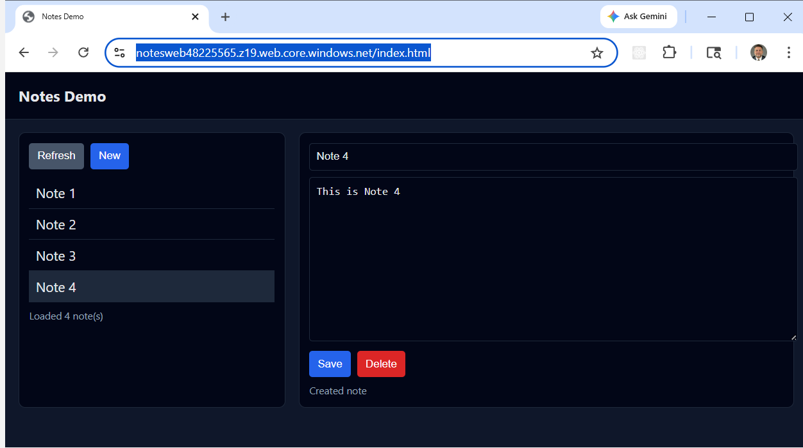
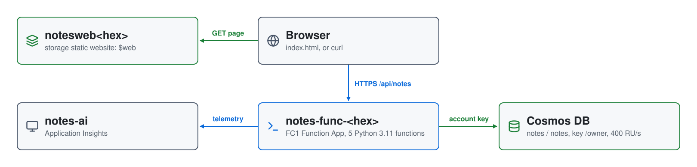

# Serverless CRUD API on Azure: Functions and Cosmos DB

A small serverless **notes** API with a browser front end. A **Flex
Consumption Function App** serves five CRUD endpoints as Python HTTP
functions, which store notes in **Cosmos DB**. A single-page web app, served
from a **storage account static website**, calls the API from the browser.



| Piece | Where | Role |
|---|---|---|
| **notes-func-&lt;hex&gt;** | `notes-rg`, Central US | Function App on the `FC1` plan (`notes-plan`), Python 3.11, up to 50 instances of 2 GB; five anonymous HTTP functions in `function_app.py`; CORS allows any origin |
| **notesfunc&lt;hex&gt;** | `notes-rg` | storage for the deployment package |
| **notes-ai** | `notes-rg` | Application Insights |
| **notes-cosmos-&lt;hex&gt;** | `notes-rg` | Cosmos DB (SQL API), session consistency; database and container `notes`, partitioned on `/owner`, 400 RU/s |
| **notesweb&lt;hex&gt;** | `notes-webapp-rg` | storage static website (`$web`) holding `index.html` and `favicon.ico` |

## Architecture

<picture>
  <source media="(prefers-color-scheme: dark)" srcset="architecture-dark.svg">
  
</picture>

Regenerate with `python3 make_diagram.py`.

- **`01-functions/`**: `main.tf` (providers, `notes-rg`), `functions.tf`
  (storage, plan, Application Insights, Function App), `cosmosdb.tf`, and
  the code in `code/function_app.py`.
- **`02-webapp/`**: the static website storage account in its own resource
  group, and `index.html.tmpl`, which `apply.sh` fills in with the API URL.

## API

Routes are under the default `/api` prefix. There's no authentication. Every
note belongs to the hardcoded owner `"global"`, the container's partition
key, so listing is a single-partition query.

| Method | Path | Function | Returns |
|---|---|---|---|
| POST | `/api/notes` | `create_note` | `201` `{id, title, note}`; `400` if `title` is missing |
| GET | `/api/notes` | `list_notes` | `{"items": [...]}` |
| GET | `/api/notes/{id}` | `get_note` | the note, or `404` |
| PUT | `/api/notes/{id}` | `update_note` | the updated note; `404` if it doesn't exist; omitted fields keep their values |
| DELETE | `/api/notes/{id}` | `delete_note` | `{"message": "Note deleted"}`, even if the note didn't exist |

Each note gets a UUID `id` and `created_at` / `updated_at` timestamps.

```bash
curl -s -X POST https://notes-func-<hex>.azurewebsites.net/api/notes \
  -H "Content-Type: application/json" \
  -d '{"title":"Test Note 1","note":"This is test note 1"}'
```

## Prerequisites

* [An Azure Account](https://portal.azure.com/)
* [Install AZ CLI](https://learn.microsoft.com/en-us/cli/azure/install-azure-cli)
* [Install Terraform](https://developer.hashicorp.com/terraform/install)
* [Install jq](https://jqlang.github.io/jq/download/), `zip` and `envsubst`

`check_env.sh` expects a service principal in `ARM_CLIENT_ID`,
`ARM_CLIENT_SECRET`, `ARM_SUBSCRIPTION_ID` and `ARM_TENANT_ID`. If this is
your first time following along, we recommend starting with this video:
[Azure + Terraform: Easy Setup](https://youtu.be/wwi3kVgYNOk).

## Deploy

```bash
git clone https://github.com/mamonaco1973/azure-crud-example.git
cd azure-crud-example
./apply.sh
```

`apply.sh` applies `01-functions`, zips `01-functions/code` and deploys it
with `az functionapp deployment source config-zip --build-remote true`,
renders `02-webapp/index.html` from the template with `envsubst`, and applies
`02-webapp`. It ends by running `validate.sh`, which creates five notes,
lists them, fetches, updates and deletes each one, and checks that a deleted
note returns `404`:

```
NOTE: Created note 1 (id=2f2d0c5a-9f5f-4d7d-9e2c-1c8a5b8e3c21)
...
NOTE: List returned 5 notes — OK
...
NOTE: Deleted note returns 404 — OK

=================================================================================
  Deployment validated!
=================================================================================
  API : https://notes-func-<hex>.azurewebsites.net/api
  Web : https://notesweb<hex>.z19.web.core.windows.net/index.html
=================================================================================
```

## Try it

1. Open the **Web** URL and add, edit and delete notes in the page.
2. Or use `curl` against the **API** URL with the routes above.

## Teardown

```bash
./destroy.sh
```

## Notes

- **Lab only.** The functions are anonymous with CORS open to any origin,
  and the Cosmos DB primary key is stored in a plain app setting
  (`COSMOS_KEY`) rather than using a managed identity.
- `check_env.sh` doesn't check for `envsubst`, which `apply.sh` needs.
